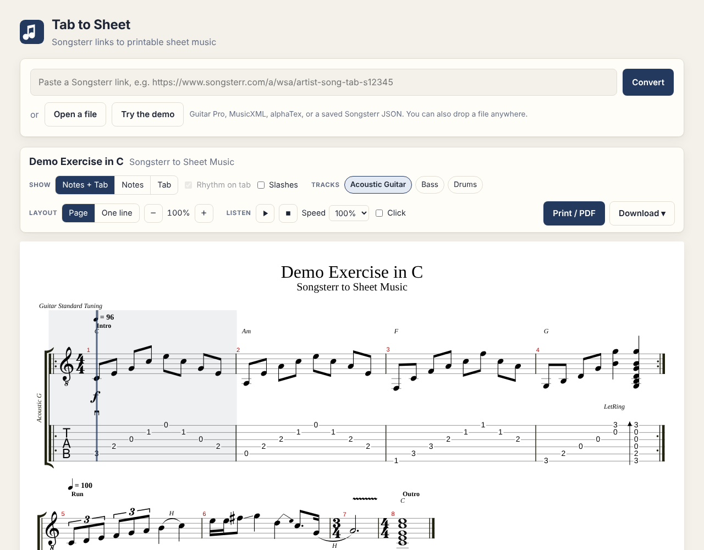
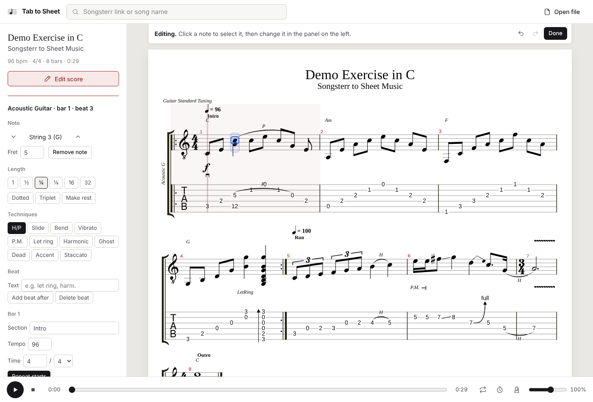

# Tab to Sheet

Turn any Songsterr tab into printable sheet music: standard notation, tablature, or both. Paste a link or search for a song, pick your tracks, and print it or save it as a PDF.

**Use it online: <https://shibeeee.github.io/songsterr-to-sheet-music/>**



## What it does

- **Paste a Songsterr link or search by name.** If the link ends in `t2` (or another track number), that track opens first.
- **Notes + Tab, Notes, or Tab**, plus optional rhythm under the tab, rhythm slashes, chord names, section names and tempo marks.
- **Choose tracks.** Show one instrument or several stacked in one score; each track shows its tuning.
- **Print or save as PDF** on A4 or US Letter, always laid out as pages. Choose how many bars go on each line.
- **Download** as Guitar Pro (`.gp`), MIDI (`.mid`), alphaTex (`.atex`) or the raw Songsterr data (`.json`, which reopens later without an internet connection).
- **Listen along**: play, pause, seek, loop (drag across bars to loop a section), count-in, metronome, speed from 25% to 150%, volume, and per-track mute and solo. Tracks get a balanced band mix (drums and bass centred, guitars spread left and right). Playback starts instantly with the small sound set while the **Better** set (GeneralUser GS, 32 MB) downloads in the background; it switches in at the next pause and is stored in your browser for next time. You can also stay on **Small**. You can also play only the tracks that are shown.
- **Open your own files**: Guitar Pro 3 to 7, MusicXML, alphaTex or saved Songsterr data. Drag a file onto the page or use **Open file**.
- **Edit the music**: click a note to change its fret, string, length or technique, add and remove notes, beats and bars, copy and paste bars, rename sections, change tempo, time signature and repeats, and rename the song or tracks. Full undo and redo.
- **Your changes are saved automatically** in your browser: reopen the song and your version is there, with a one-click way back to the original. Recent songs you've changed are marked "edited". Download Guitar Pro to share your version or move it to another device.
- **Optimize fingering**: re-chooses the string and fret of every note so the part needs the fewest hand shifts, keeping every pitch. It follows the fretting hand (one finger per fret over four frets), stays in position as long as it can, and shifts during rests and open strings when it has to. Chords stay playable, and tied notes, hammer-ons and slides stay on one string. Works on guitar and bass, for the whole song or just the bars shown.
- **Convert 5 or 6-string bass to 4-string** (standard E A D G): notes below low E move up an octave, then the fingering is optimized. Basses with 5 or 6 strings get a **Make 4-string** button right in the track list. Set **Frets on your instrument** so the optimizer never uses frets you don't have.
- **Show only some bars** (for example bars 9 to 24) on screen and when printing.
- **Remembers** your recent songs, your settings, and for each song which tracks and bars you had showing.
- **Quick to use**: paste a Songsterr link and it opens straight away; arrow keys move through search results; sidebar sections fold away; **Options** hides the panel to give the music the full width; press <kbd>?</kbd> for every shortcut.
- Keyboard shortcuts: <kbd>Space</kbd> play or pause, <kbd>Esc</kbd> stop, <kbd>L</kbd> loop, <kbd>M</kbd> metronome, <kbd>+</kbd>/<kbd>-</kbd> size, <kbd>P</kbd> print, <kbd>E</kbd> edit, <kbd>?</kbd> all shortcuts.



### Editing keys

While editing: <kbd>←</kbd>/<kbd>→</kbd> move between beats, <kbd>↑</kbd>/<kbd>↓</kbd> change string, <kbd>0</kbd>–<kbd>9</kbd> type a fret (two digits in a row make 10 to 36), <kbd>Delete</kbd> remove the note, <kbd>R</kbd> make a rest, <kbd>[</kbd>/<kbd>]</kbd> longer or shorter, <kbd>.</kbd> dotted, <kbd>Enter</kbd> add a beat after, <kbd>Ctrl</kbd>+<kbd>C</kbd>/<kbd>V</kbd> copy a bar and paste it over another, <kbd>Ctrl</kbd>+<kbd>Z</kbd> undo, <kbd>Ctrl</kbd>+<kbd>Shift</kbd>+<kbd>Z</kbd> redo, <kbd>Esc</kbd> stop editing.
- Works on phones, and follows your system's light or dark setting.

Supported techniques include ties, hammer-ons and pull-offs, slides, bends, vibrato, palm mutes, let ring, dead and ghost notes, harmonics, accents, staccato, grace notes, tuplets, strums, pick strokes, dynamics, repeats, alternate endings, and time signature and tempo changes.

## How the website gets songs

The website is static (GitHub Pages), so your browser does the fetching. It tries these routes in order and remembers the one that worked:

1. **Directly from Songsterr.**
2. **A relay of your own**, if the site or you have one configured (see below).
3. **Public relays** (free CORS relay services, which come and go).

If none of them answers, the page explains the fallbacks: a **bookmark** you click on the Songsterr page, setting up a relay, or running the app yourself. Most of the time you won't need any of them.

### Your own relay (recommended)

`relay/worker.js` is a tiny Cloudflare Worker that fetches from Songsterr for the site. It only forwards requests to Songsterr's own addresses, so nobody can use it as an open proxy. Cloudflare's free plan is plenty. The deploy workflow publishes it and connects the site to it automatically once GitHub has two Cloudflare codes:

1. Sign up at [dash.cloudflare.com](https://dash.cloudflare.com) (free) and open **Workers & Pages** once, so your `workers.dev` address gets created.
2. Go to **My Profile → API Tokens → Create Token**, choose the **Edit Cloudflare Workers** template, and create the token. Copy it.
3. Copy your **Account ID** (on the right of the Workers & Pages overview page).
4. In this GitHub repo, open **Settings → Secrets and variables → Actions → New repository secret** and add:
   - `CLOUDFLARE_API_TOKEN` = the token
   - `CLOUDFLARE_ACCOUNT_ID` = the account ID
5. Open **Actions → Deploy website → Run workflow**.

**Or connect the repo in Cloudflare instead:** Workers & Pages → Create → Import a repository, pick this repo, keep the root directory `/` and the deploy command `npx wrangler deploy` (the build command can be left empty). The Worker's name must match `name` in `wrangler.toml`. Then put the Worker's address (from its Overview page) into `site.config.json`.

The workflow deploys the relay using `wrangler.toml`, reads its address, and builds the site to use it first. The site's relay address lives in `site.config.json`; a repository variable called `RELAY_URL` overrides it. You can also paste a relay address under "If a Songsterr link won't load" on the home page, which only affects your own browser.

## Run it yourself

With your own copy, links always work, because the small server fetches from Songsterr on your behalf. You need [Node.js](https://nodejs.org) 18.17 or newer.

```bash
npm install
npm start
```

Open <http://localhost:3000>. For the better instrument sounds, run `npm run fetch-sounds` once (it downloads them into `.cache/`). Set `PORT` to use another port, or `HOST=0.0.0.0` to reach it from other devices on your network.

## Project layout

| Path | What it is |
| --- | --- |
| `public/index.html`, `public/css/styles.css` | The page. |
| `public/js/app.js` | The interface: loading, options, tracks, player, print, export. |
| `public/js/convert.js` | Turns Songsterr's JSON into an [alphaTab](https://alphatab.net) score. |
| `public/js/songsterr.js` | Talks to Songsterr: link parsing, search, song and track download. Shared by the browser and the server. |
| `public/js/sources.js` | How the browser reaches Songsterr (server, direct, relays). |
| `public/js/bookmarklet.js` | The fallback bookmark. |
| `public/js/storage.js` | Recent songs, settings, remembered views and saved edits. |
| `public/js/sound.js` | Downloads and stores the instrument sounds. |
| `public/js/editor.js` | Editing operations (notes, rhythm, bars, song details) and undo snapshots. |
| `public/js/edit-ui.js` | The edit panel, selection highlight and editing keys. |
| `public/js/fingering.js` | Fingering optimizer and 5/6-string to 4-string bass conversion. |
| `server.js` | Optional local server (`npm start`). |
| `relay/worker.js`, `wrangler.toml` | The relay for the hosted site and its Cloudflare settings. |
| `scripts/build-static.js` | Builds the static site into `dist/` (`npm run build`). |
| `scripts/fetch-sounds.js` | Downloads the better instrument sounds (`npm run fetch-sounds`). |
| `.github/workflows/pages.yml` | Tests, builds and publishes the site on every push. |
| `public/demo/demo-song.json` | An original practice exercise used for the example and the tests. |

Songsterr has no official public API for tab data, so if they change their site the fetching code may need updating. Files you open yourself don't depend on Songsterr at all.

## Tests

```bash
npm test
```

## Notes

For personal practice. Tabs belong to Songsterr and its contributors, and songs to their writers, so please respect Songsterr's terms and don't redistribute what you download.

Notation, playback and file export come from [alphaTab](https://github.com/CoderLine/alphaTab) (MPL-2.0), which ships with the Bravura music font and the Sonivox sound font. The better sounds are GeneralUser GS by S. Christian Collins (free to use in software; a local copy is hosted with the site, as its license asks); its license file is published next to it.
